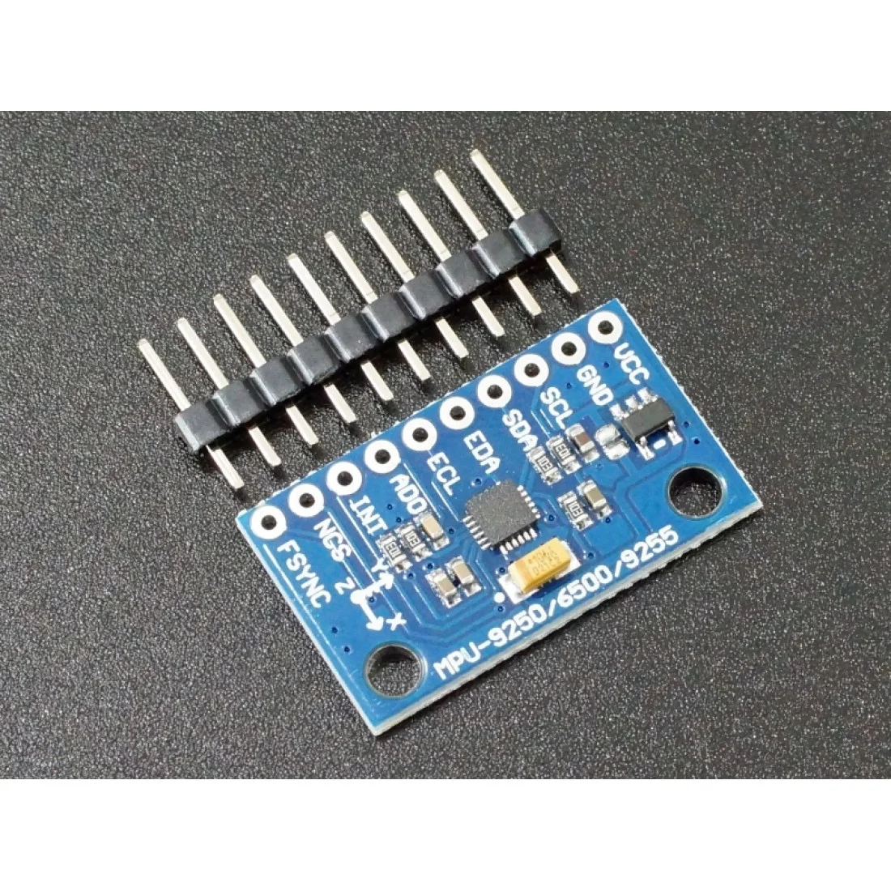
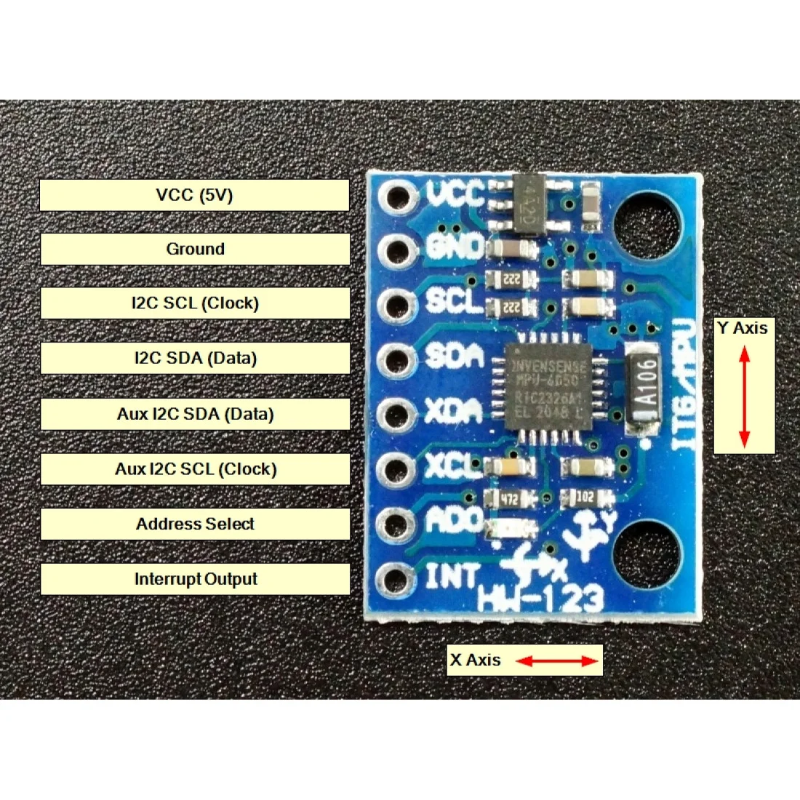
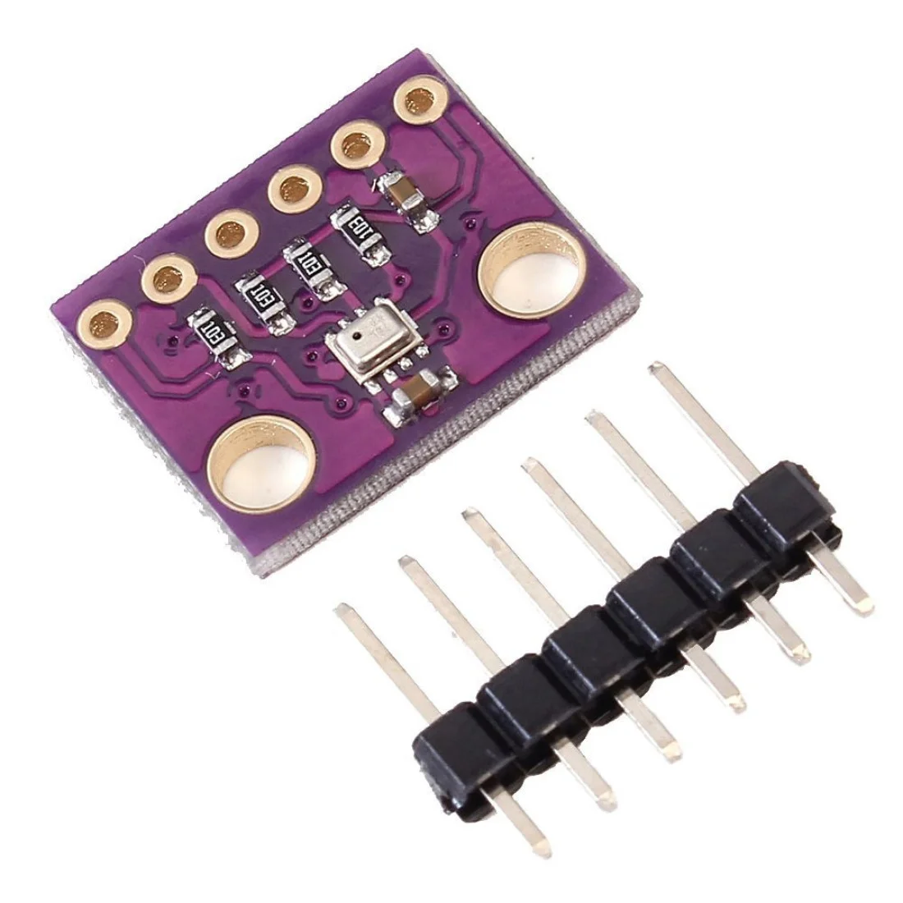
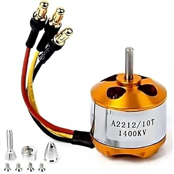
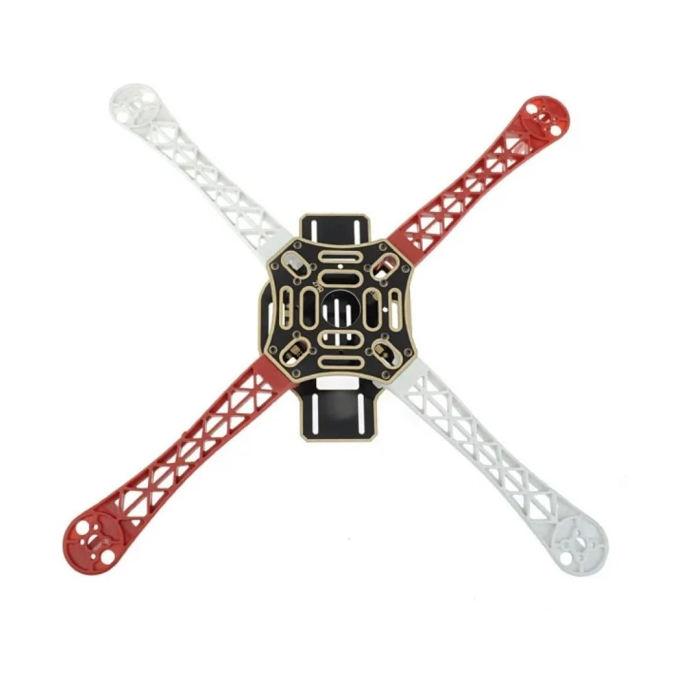
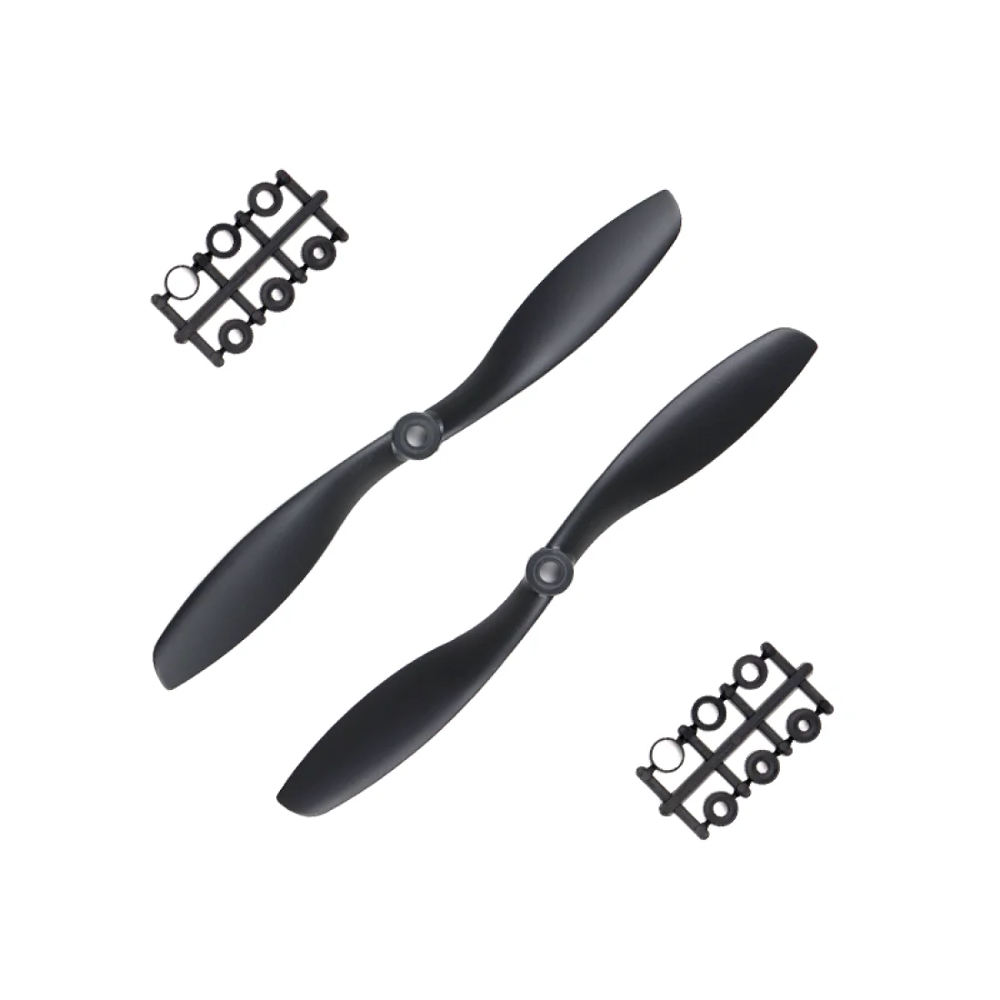

## Hardware Specifications

### 1. Sensors & Navigation

* **IMU (Gyroscope & Accelerometer)**
  * **MPU6500 / MPU9250** — Interface: SPI / $I^2C$

 

  * **MPU6050** — Interface: $I^2C$
* **Barometer**
  * **BMP280** — Interface: $I^2C$ (Altitude & pressure sensing)

---

### 2. Propulsion System

#### Electronic Speed Controllers (ESCs)
* **Quantity:** 4x
* **Type:** Generic 30A ESCs
* **Continuous Current:** 30A

#### Motors (BLDC)
* **Quantity:** 4x
* **Type:** Brushless DC (BLDC)
* **Velocity Constant:** 1400KV

---

### 3. Airframe

* **Type:** Quadcopter Frame (X-Configuration)
* **Frame** F450 Mini Quadcopter Frame 450MM

* **Propellers** 2 Pair 10x45 inch ABS 

